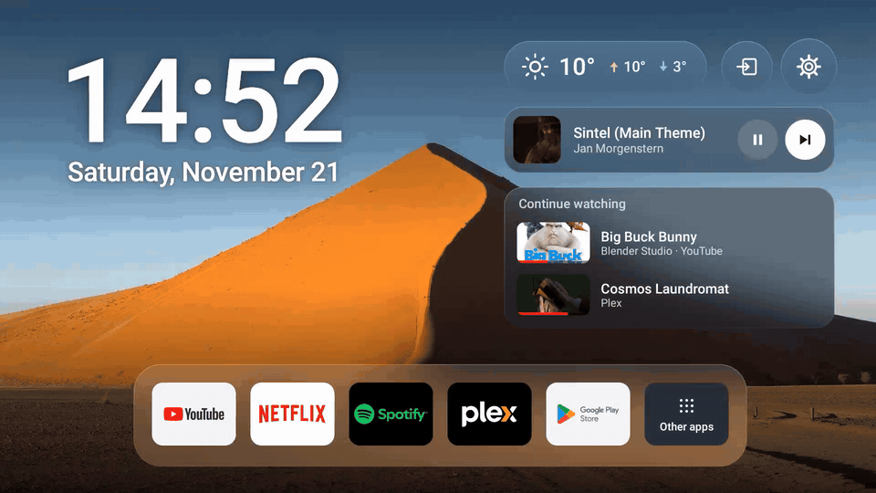

# MyTV Launcher

**A calm, fast home screen for Android TV and Google TV.** Your apps in one row, the time and the weather on a photo
of your choice, and what is playing in your home, all with the arrows and OK on your remote. No account, no ads, no
recommendations.

## What it does

- A **dock** with the apps you choose, in your order, and two buttons of your choice.
- **Background photos** that change by themselves, or your own photos sent from your phone.
- **Weather** for the next hours and eight days, with sun and moon.
- **Now playing** on Sonos, Google Cast, other speakers and apps on the TV.
- **Continue watching** from your apps, YouTube and your own Plex server, in the right episode where the app allows it.
- The **Home button** opens MyTV, also on TVs that do not let you choose another home screen; the **Sources button**
  opens MyTV's Sources, and the coloured and number buttons can get a function.
- A **screensaver**, night mode, a sleep timer and **quiet hours** (a maximum volume in the evening).
- **Profiles** for parents and children, with a PIN.
- **Settings backup** to your phone, and **34 languages**.

More, with screenshots: [docs/FEATURES.md](docs/FEATURES.md).

## Install

On the TV, with only the remote:

1. Install **[Downloader](https://play.google.com/store/apps/details?id=com.esaba.downloader)** from the Google Play
   Store (on the website you can choose your TV and install it from your phone or computer).
2. Open it and type the code **3805347**.
3. Allow Downloader to install apps when the TV asks, then **Install** and **Open**.

The welcome screen does the rest, including the Home button. A computer installer, help when something goes wrong, and
how to remove MyTV again: [docs/INSTALL.md](docs/INSTALL.md).

Works on Android TV and Google TV with Android 8.0 or newer. Tested on several Philips Android TVs; does it work on
yours?
[Tell us](https://github.com/tinteractive/MyTV/issues/new?template=device_report.yml).

## More

- [Privacy and permissions](docs/PRIVACY.md): what leaves the TV, and why MyTV asks for what it asks.
- [Problems and ideas](https://github.com/tinteractive/MyTV/issues/new/choose) · [Security](SECURITY.md) ·
  [Changes](CHANGELOG.md)
- [Contributing](CONTRIBUTING.md) · [Building from source](docs/DEVELOPMENT.md) · [How it works](docs/ARCHITECTURE.md)
- [Credits](docs/CREDITS.md): photos, weather data, icons and libraries.

## Licence

[GPL-3.0-only](LICENSE): you may use, study, change and share MyTV Launcher; a changed version you share must come with
its source under the same licence. The background photos have their own open licences ([credits](docs/CREDITS.md)).

MyTV Launcher is an independent project, not affiliated with or endorsed by Google, Philips, Sonos or any other company
named here. Android, Android TV, Google TV, Google Cast, Chromecast and YouTube are trademarks of Google LLC; other
names are trademarks of their owners and are used only to say what MyTV works with.
