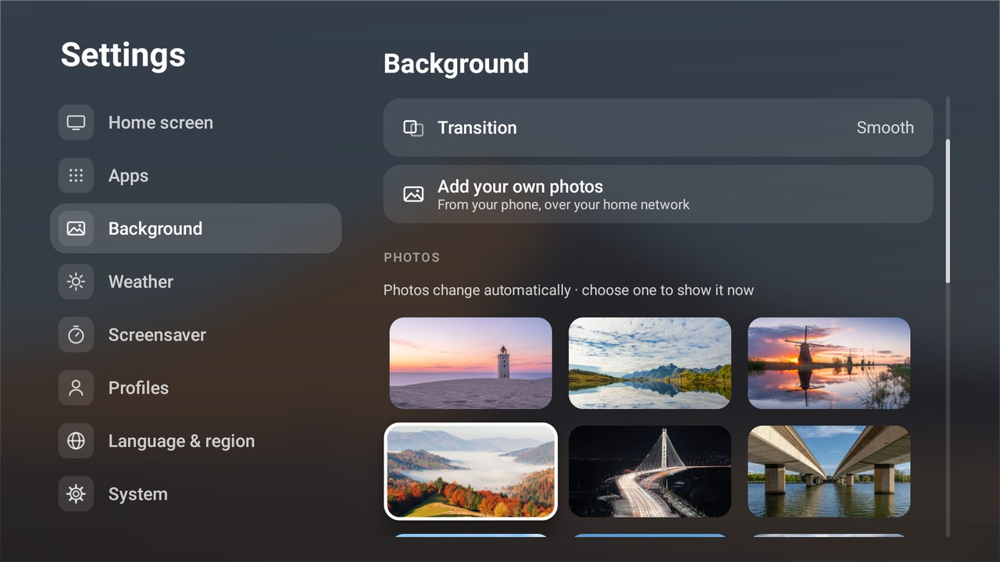

# MyTV Launcher

**A calm, fast home screen (launcher) for Android TV and Google TV.**
Your favourite apps in one row, the time and the weather on a photo of your choice, and what is playing in your
home — all reachable with the arrow keys and OK on your remote. No account, no ads, no recommendations.


> This repository contains the **releases** of MyTV Launcher ("MyTV" for short; the APK) and this description. The source code will be published here as well; the timing is not known yet.

---

## Contents

- [Features](#features)
- [Screenshots](#screenshots)
- [Requirements](#requirements)
- [Installation](#installation)
  - [Option A: from a computer with ADB (recommended)](#option-a-from-a-computer-with-adb-recommended)
  - [Option B: on the TV with the Downloader app](#option-b-on-the-tv-with-the-downloader-app)
  - [Option C: from your phone](#option-c-from-your-phone)
- [First start](#first-start)
- [Making the Home button open MyTV](#making-the-home-button-open-mytv)
- [Optional extras (network debugging)](#optional-extras-network-debugging)
- [Updates](#updates)
- [Privacy](#privacy)
- [Removing MyTV / going back](#removing-mytv--going-back)
- [Using the remote](#using-the-remote)
- [Problems and ideas](#problems-and-ideas)
- [Credits](#credits)

---

## Features

**Home screen**
- Large clock and date, weather with today's high and low, and a dock with your apps (choose which, and their order).
- Background photos that change by themselves (at random), or one fixed photo; a set of open-licence photos that MyTV downloads once (a few included), or add your own.
- **Now playing**: what plays on Sonos speakers, Google Cast devices (Nest/Chromecast), other speakers
  (Denon/Marantz HEOS, Yamaha MusicCast, Bluesound/BluOS, Bose SoundTouch, DLNA/UPnP) and apps on the TV
  (such as Spotify and YouTube; apps that do not tell Android what they play, such as Plex, are not shown), with play/pause and next. Shown only when something plays.
  Hold OK on the card to open the app, hide the card until something else plays, or stop.
- **Continue watching**: what you were watching, on its own panel, also for apps that do not publish it themselves
  (such as YouTube); OK continues where you stopped. Hold OK on a card to remove it. A title counts as watched from
  95 % (the credits).
- **Sources**: switch to HDMI devices and live TV in one press; connected devices first.
- Two **buttons of your choice** top right: All apps, Sources, Bluetooth, Sleep timer, Android settings,
  the original Google TV home, or any app. The settings button always stays.

**Weather**
- Current weather, the next hours and eight days, wind, humidity, rain, sunrise/sunset and moon phase.
- Data from Open-Meteo (MET Norway when Open-Meteo cannot be reached); your place is set by name (city level only).
- When there is no current weather (no internet for a few hours), the weather is simply not shown until it is back.

**Comfort**
- **Screensaver** with the photos, a drifting clock and the weather.
- **Night mode**: the photo gets darker and warmer after sunset (or 22:00–07:00).
- **Sleep timer** (15–120 min). In the last minute a countdown appears in the middle of the screen, over whatever is playing.
- **Quiet hours** (Settings → System): in the evening and at night the volume never goes above a maximum you choose, whichever remote is
  used. Works for the TV's own speakers and for a Sonos soundbar on HDMI (Arc, Beam, Ray, Playbar, Playbase, Amp);
  headphones are never limited. Not offered when the sound goes to a soundbar MyTV cannot control.
- **Burn-in protection** for OLED screens: everything shifts a few pixels and dims after 10 idle minutes.
- **Bluetooth**: connect or disconnect paired headphones and speakers, pair new ones.

**Profiles**
- Parent and child profiles, each with its own dock, hidden apps, background and icon.
- A child profile has no settings and only the apps you choose; going back to a parent profile needs a PIN.
- Optional "Who is watching?" when the TV is switched on.

**Your own photos**
- Scan a QR code with your phone (same Wi-Fi), pick photos, send. Works only while that screen is open, with a PIN.

**Settings backup**
- Settings → System → **Settings backup**: save all settings to your phone, and put them back later,
  or on another TV, the same way (QR code and PIN).
  Permissions that were on are asked for again after restoring. Restoring is also offered in the welcome screen.

**Apps**
- Rename apps, choose a picture (banner, icon or letter), move apps to "Other apps", set a start-up app that opens
  when the TV is switched on (a streaming app waits until the internet works).
- **Clean up**: switch off pre-installed apps you never use (nothing is deleted; everything can be switched back on).

**Languages**: English, Dutch, French, German, Spanish and Portuguese (follows the TV, or choose one).

---

## Screenshots

| Home | Weather |
|---|---|
|  |  |

| Settings | System settings |
|---|---|
|  |  |

| App menu | Background |
|---|---|
|  |  |

---

## Requirements

- An **Android TV** or **Google TV** with **Android 8.0 or newer** (TVs, boxes and sticks).
- Developed and tested on a **Philips 2021/22 UHD Android TV (Android 11)**. Other brands should work; the Home button,
  screensaver and inputs are looked up per TV.
- Internet for the weather, the background photos and (optional) updates. Everything else works on your home network
  or on the TV itself.

---

## Installation

Download the newest `mytv-<version>.apk` from the [Releases page](https://github.com/tinteractive/MyTV/releases/latest).

### Option A: from a computer with ADB (recommended)

This also lets you switch on the optional extras.

1. **On the TV, switch on developer options**: Settings → Device preferences → About → press OK on **Build** seven times.
   (On some TVs these menus are one level deeper, for example under Settings → Android settings.)
2. **Switch on debugging**: Settings → Device preferences → Developer options → **USB debugging** and, if present,
   **Network debugging** / **ADB over network**.
3. **Find the TV's IP address**: Settings → Network & Internet → your network.
4. **On the computer**, install Google's
   [Android platform tools](https://developer.android.com/tools/releases/platform-tools) (contains `adb`), then:
   ```
   adb connect <tv-ip>:5555
   ```
   The TV asks **"Allow USB debugging?"** — choose **Always allow from this computer** and **OK**.
5. **Install MyTV**:
   ```
   adb install -r mytv-<version>.apk
   ```
6. **Recommended** — let MyTV keep its Home-button helper switched on and manage a few settings itself:
   ```
   adb shell pm grant com.tinteractive.mytv android.permission.WRITE_SECURE_SETTINGS
   ```
7. Open MyTV from the apps list (or `adb shell monkey -p com.tinteractive.mytv 1`).

### Option B: on the TV with the Downloader app

1. On the TV, install **Downloader** (by AFTVnews) from the Google Play Store.
2. Allow it to install apps: Settings → Device preferences → Security & restrictions → **Unknown sources** →
   switch on **Downloader** (the wording differs per TV; Android 8+ asks the first time you install).
3. In Downloader, open `github.com/tinteractive/MyTV/releases/latest`, choose the `mytv-<version>.apk` file and install it.
4. Open MyTV from the apps list.

Without a computer: switch on **network debugging** on the TV (developer options, as in option A) and choose
Settings → System → **Set up extra permissions** in MyTV (also offered in the welcome screen). The TV asks
**"Allow debugging?"** once; MyTV then gives itself the permission of option A step 6. Afterwards
**Switch off network debugging** closes the debugging connection again (Clean up is hidden until it is back on).

### Option C: from your phone

Apps such as **Send files to TV** (on both the phone and the TV) can send the APK file to the TV, where you open it
with a file manager and install it. Allow "unknown sources" for that file manager as in option B.

---

## First start

A short welcome guides you through: **language → your place (for the weather) → Home button → start-up app →
profiles**. Every step can be skipped and changed later under Settings.

---

## Making the Home button open MyTV

Many TVs let you choose the home screen: Settings → System → **Make MyTV the default home** asks Android for it
(also offered in the welcome screen; not shown when MyTV already is the default, or when the TV does not allow it).

Other TVs always open their own home screen when you press Home. For those, MyTV includes a small helper that notices
this and brings MyTV to the front instead (it only sees which app comes to the front; it reads nothing on the screen).

- With the permission from installation step 6, MyTV switches the helper on itself.
- Otherwise: TV settings → Device preferences → **Accessibility** → **MyTV Home button** → on.
  The welcome screen has a button that takes you there.
- Optional, with network debugging on: Settings → System → **Google TV home** → off. Home then goes to MyTV
  directly and the original home stops using memory (about 100 MB). It can always be switched back on.

---

## Optional extras (network debugging)

Two functions use the TV's own debugging connection (adb on port 5555). They are only shown in MyTV while
**network debugging** is switched on:

| Function | Where |
|---|---|
| Clean up (switch pre-installed apps off/on) | Settings → System → Clean up |
| Switch the Google TV home off/on | Settings → System |

Two others work without it:

- **Sleep timer** (Settings → System, or as a button top right): uses MyTV's Home-button helper, so it needs that
  switched on (see above).
- **Screensaver "Start after"** (Settings → Screensaver): needs the permission from installation step 6. On TVs
  that have Android's "Modify system settings" screen, MyTV can also ask for it there.

The first time, the TV asks **"Allow USB debugging?"** for MyTV itself; choose *Always allow*. If you switch network
debugging off again, these functions simply disappear; everything else keeps working.

> Security note: with network debugging on, devices on your home network can ask to connect. Only accept the prompt
> for computers you know.

---

## Updates

MyTV can update itself from this repository. It is **off by default**:

- **Settings → System → Updates → Check now**, or switch on **Check automatically** (once a week).
- A check downloads only `update.json` from the newest release (a few KB). If there is a newer version, MyTV shows
  what is new since your version — in your language — with **Skip** and **Install**.
- **Install** downloads that version's APK, checks its size and SHA-256 against `update.json`, checks that it is
  MyTV signed with the same key and newer than yours, and then hands it to Android's own installer, which asks you to
  confirm. The download is deleted afterwards.
- **Skip** hides that version until a newer one appears.

The first time, Android asks to allow MyTV to install apps ("Install unknown apps").

---

## Privacy

- No account, no tracking, no ads, no analytics.
- **Weather**: your place (city level) is sent to [Open-Meteo](https://open-meteo.com), or to
  [MET Norway](https://api.met.no) when Open-Meteo cannot be reached.
- **Approximate place** in the welcome screen and weather settings: your internet address is looked up once at
  [ipapi.co](https://ipapi.co) (city level).
- **Updates**: only when you check (or weekly, if you switch that on), from GitHub.
- **Background photos**: once a day MyTV reads the photo list from GitHub and downloads new photos (only the photos;
  nothing is sent).
- **Continue watching for YouTube**: YouTube does not tell Android which video plays, so MyTV looks up the title
  and channel once on YouTube to find it again. Your watching history itself stays on the TV.
- Speakers, Cast devices and your own photos stay on your home network. Settings stay on the TV; a settings backup
  goes only to your own phone, over your home network.

---

## Removing MyTV / going back

- **Uninstall**: Settings → Apps → MyTV Launcher → Uninstall, or `adb uninstall com.tinteractive.mytv`. Android's own home comes
  back by itself.
- If you switched the Google TV home off, switch it back on first (Settings → System), or:
  `adb shell pm enable com.google.android.tvlauncher`
- Apps switched off with Clean up: Settings → System → Clean up → **Switch everything back on**, or
  `adb shell pm enable <package>`.

---

## Using the remote

| Key | Action |
|---|---|
| Arrows | Move |
| OK | Open |
| Hold OK (or Menu) on an app | Move, rename, picture, "Other apps", app info |
| Hold OK on Now playing | Open the app, hide the card, stop |
| Hold OK on Continue watching | Continue, remove from the row |
| Back | Close the open screen |
| Home | Back to MyTV |
| Number keys | Enter a PIN |

---

## Problems and ideas

Found a problem, or have an idea? Open an [issue](https://github.com/tinteractive/MyTV/issues/new/choose).
Please mention your TV or box and the MyTV version (Settings → System → About MyTV Launcher).
Security problems: please report them [privately](https://github.com/tinteractive/MyTV/security/advisories/new).

---

## Credits

- Background photos: [Wikimedia Commons](https://commons.wikimedia.org) (CC BY / CC BY-SA; author and licence of
  each photo under Settings → System → About MyTV Launcher).
- Weather and moon data: [Open-Meteo](https://open-meteo.com) (CC BY 4.0).
- Weather when Open-Meteo cannot be reached: [MET Norway](https://api.met.no) (CC BY 4.0).
- Weather icons: [Lucide](https://lucide.dev) (ISC).
- Moon calculation: based on [SunCalc](https://github.com/mourner/suncalc) by Vladimir Agafonkin (BSD-2-Clause).
- QR codes: [ZXing](https://github.com/zxing/zxing) (Apache-2.0).
- Built with Kotlin, Jetpack Compose and AndroidX (Apache-2.0).
