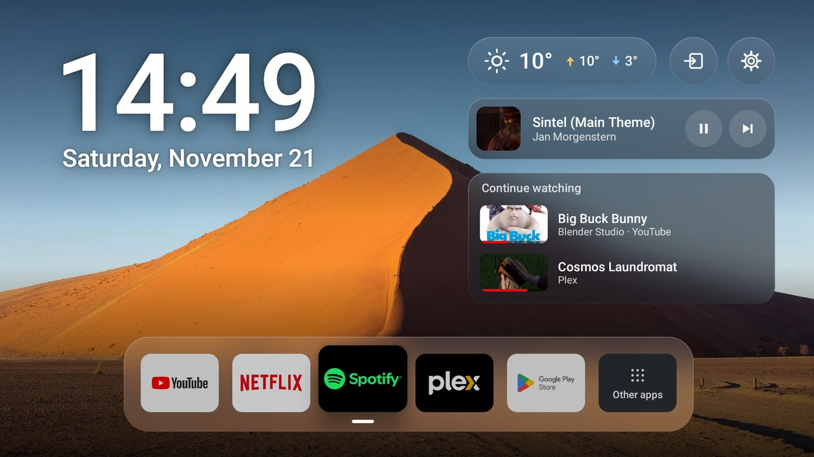
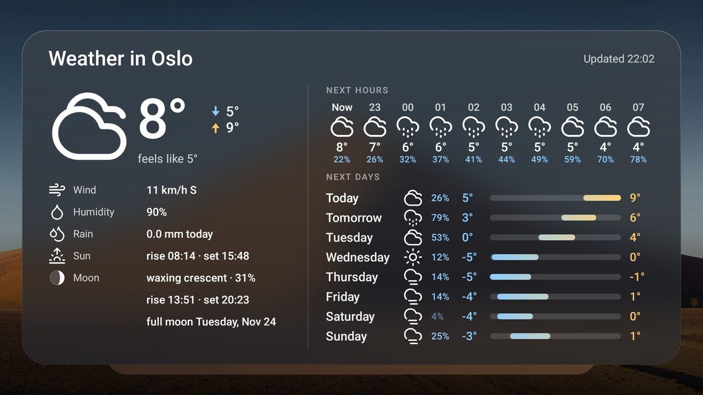
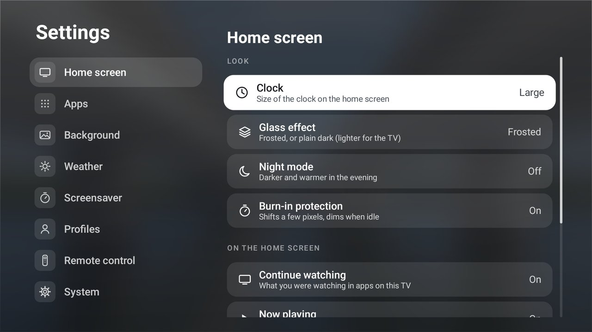
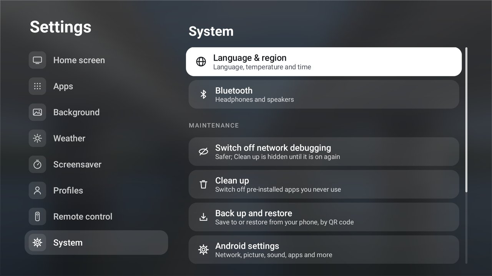
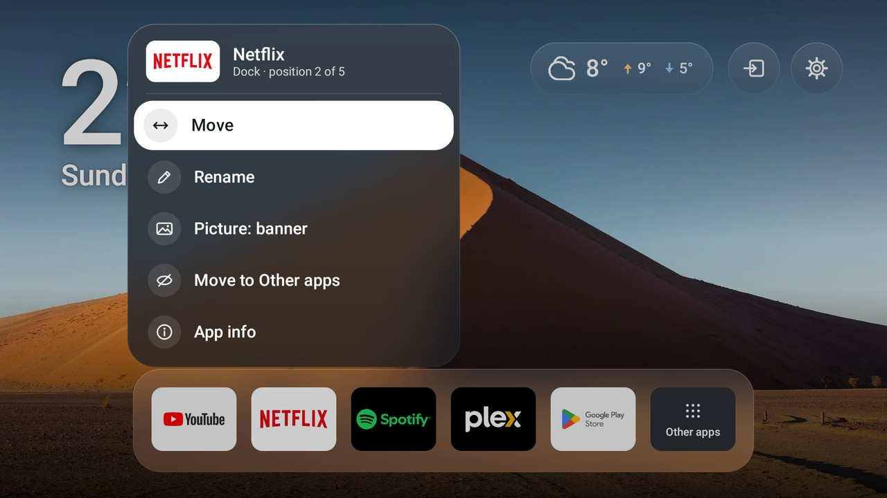
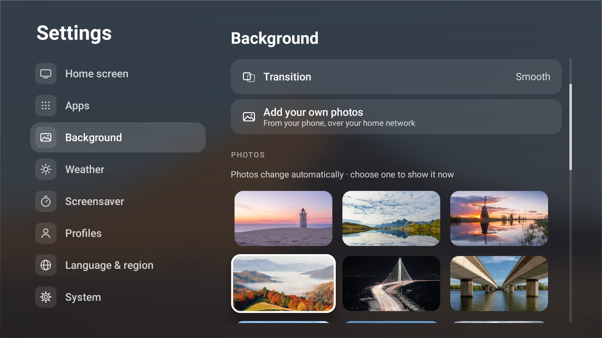
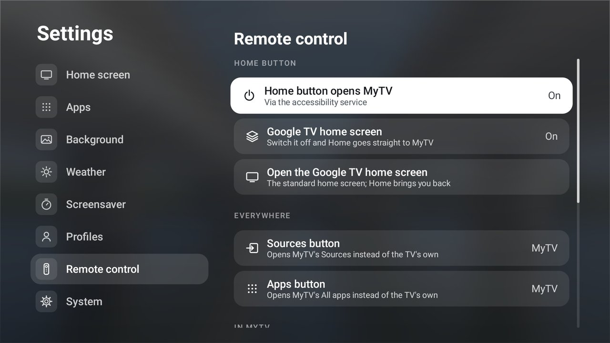
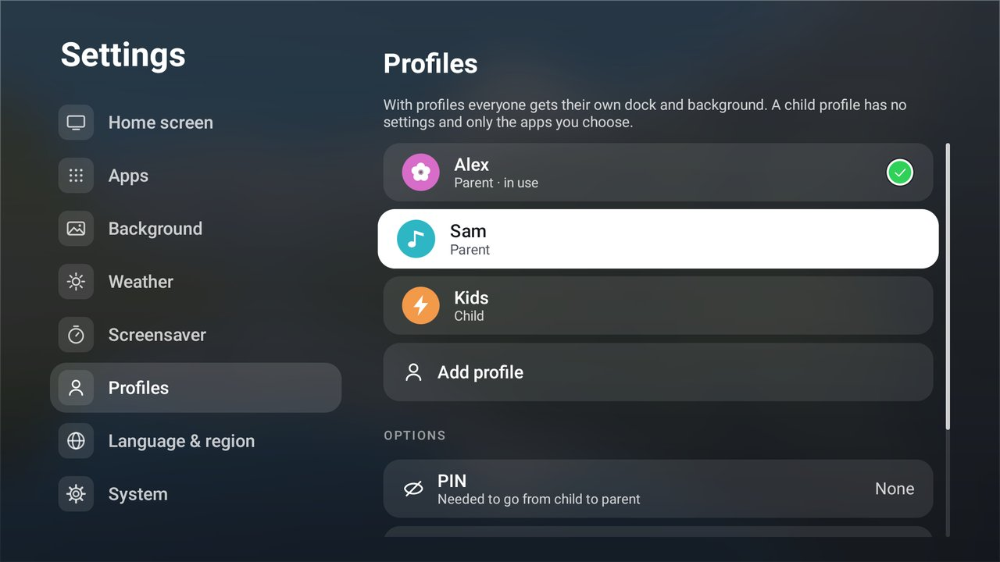

# What MyTV Launcher does

[Home screen](#home-screen) · [Weather](#weather) · [Comfort](#comfort) · [Profiles](#profiles) ·
[Photos](#your-own-photos) · [Backup](#settings-backup) · [Apps](#apps) · [Remote](#using-the-remote) ·
[Screenshots](#screenshots)

## Home screen

- Large clock and date, the weather with today's high and low, and a dock with your apps (you choose which, and their
  order).
- Background photos that change by themselves (at random), or one fixed photo: a set of open-licence photos that MyTV
  downloads once (a few are included), or your own.
- **Now playing:** what plays on Sonos speakers, Google Cast devices (Nest, Chromecast), other speakers
  (Denon/Marantz HEOS, Yamaha MusicCast, Bluesound/BluOS, Bose SoundTouch, DLNA/UPnP) and apps on the TV (such as
  Spotify and YouTube), with play/pause and next. Shown only while something plays. Apps that do not tell Android what
  they play (such as Plex) are not shown. OK on the card opens the app; Right goes to play/pause and next. Hold OK
  to hide the card until something else plays, or stop.
- **Continue watching:** what you were watching, on the right under the weather, also for apps that do not publish it
  themselves (such as YouTube) and from your own Plex server. OK continues where you stopped, in the right episode
  where the app allows it; hold OK on a card to remove it. Adverts and trailers do not count; a title counts as
  watched from 95 % (the credits). Settings → Home screen → **Continue watching** switches it on or off and chooses
  its sources (Plex, and each app on or off). Plex appears there when the Plex app is installed: link it once with a
  code at plex.tv/link.
- **Sources:** switch to HDMI devices and live TV in one press; connected devices first.
- Two **buttons of your choice** at the top right: All apps, Sources, Bluetooth, Sleep timer, Android settings, the
  TV's own home screen, or any app. The settings button always stays.

## Weather

- The current weather, the next hours and eight days, wind, humidity, rain, sunrise and sunset, and the moon.
- From Open-Meteo, or MET Norway when Open-Meteo cannot be reached. Your place is set by name (city level only).
- Without current weather (no internet for a few hours) the weather is simply not shown until it is back.

## Comfort

- **Screensaver** with the photos, the clock and the weather. The clock moves to another corner every minute, so
  nothing stays on the same pixels.
- **Night mode:** the photo gets darker and warmer after sunset (or between 22:00 and 07:00).
- **Sleep timer** (15–120 minutes). In the last minute a countdown appears in the middle of the screen, over whatever
  is playing.
- **Quiet hours** (Settings → Screensaver): in the evening and at night the volume never goes above a maximum you choose,
  whichever remote is used. For the TV's own speakers and for a Sonos soundbar on HDMI (Arc, Beam, Ray, Playbar,
  Playbase, Amp); headphones are never limited. Not offered when the sound goes to a soundbar MyTV cannot control.
- **Burn-in protection** for OLED screens: the home screen shifts a few pixels now and then and dims after ten minutes
  without a key press.
- **Bluetooth:** connect or disconnect paired headphones and speakers, pair new ones.
- **Low battery:** when a connected Bluetooth device (headphones, a remote) drops below 15 %, a notice shows on the
  home screen for 15 seconds.

## Profiles

- Parent and child profiles, each with its own dock (apps and order), background and picture, and optionally its
  own Plex Home user for Continue watching (the profile's page → Plex).
- A child profile has no settings and only the apps a parent chose; a new child profile starts with the apps of the
  dock. Going back to a parent profile needs a PIN.
- Optionally "Who is watching?" when the TV is switched on.

## Your own photos

Scan a QR code with your phone (on the same Wi-Fi), pick photos and send them. The phone page works only while that
screen is open on the TV, and is protected by a PIN.

## Settings backup

Settings → System → **Back up and restore** saves all settings to your phone, and puts them back later or on another TV,
the same way (QR code and PIN). Permissions that were on are asked for again after restoring. Restoring is also
offered in the welcome screen. What Clean up switched off is not in the backup: it belongs to that TV.

**Other TVs** (Settings → System) keeps two TVs in the house the same, without a phone: open the screen on both
TVs, choose the other TV and enter the code it shows. That links them once. From then on, either TV can take over
all settings of the other (OK twice), the same settings as in a backup, and its own photos: afterwards both TVs have
the same photos. Things that belong to one TV stay with it (buttons taught to MyTV for that remote, what Clean up
switched off, the PIN). Everything goes encrypted over your home network; Unlink ends it.

With **Keep this TV the same**, a TV follows a linked TV: when the TV or MyTV starts, and every 5 minutes on the home
screen once the remote was left alone for 2 minutes, it checks whether the other TV changed and takes over everything
by itself (quietly, never while someone is using it; when the other TV is off, the next time). It keeps the
profile in use. Settings → System shows which TV it follows, and on the other TV which TVs follow it.

## Apps

- Rename apps, choose their picture (banner, icon or letter), move them to "Other apps".
- A **start-up app** that opens when the TV is switched on (a streaming app waits until the internet works).
- **Clean up:** switch off pre-installed apps you never use. Nothing is deleted; everything can be switched back on.
  If the TV switches some back on by itself (for example after a power cut), MyTV switches them off again.

34 languages (follows the TV, or choose one), also right-to-left for Arabic, Hebrew and Persian: Arabic, Bulgarian,
Chinese (Simplified and Traditional), Croatian, Czech, Danish, Dutch, English, Finnish, French, German, Greek, Hebrew,
Hindi, Hungarian, Indonesian, Italian, Korean, Norwegian, Persian, Polish, Portuguese (Brazil and Portugal), Romanian,
Russian, Serbian, Slovak, Spanish, Swedish, Thai, Turkish, Ukrainian and Vietnamese.

## Using the remote

| Key | Action |
|---|---|
| Arrows | Move |
| OK | Open |
| Hold OK (or Menu) on an app | Move, rename, picture, "Other apps", app info |
| OK on Now playing | Open the app |
| Hold OK on Now playing | Hide the card, stop |
| Hold OK on Continue watching | Continue, remove from the list |
| Back | Close the open screen |
| Home | Back to MyTV |
| Sources (input) button | MyTV's Sources, also over the app that is playing (it keeps playing) |
| Apps button | MyTV's All apps |
| Red, green, yellow, blue | A function you choose (an app, Sources, Bluetooth, sleep timer…), on MyTV's home screen |
| Number keys 1–9 | Open the apps in the dock (when switched on); enter a PIN |

Settings → **Remote control** sets what these buttons do. A remote that sends its own code for a button (some
brands do): choose **Teach another button…** and press it.

## Screenshots

| Home | Weather |
|---|---|
|  |  |

| Settings | System settings |
|---|---|
|  |  |

| App menu | Background |
|---|---|
|  |  |

| Remote control | Profiles |
|---|---|
|  |  |
